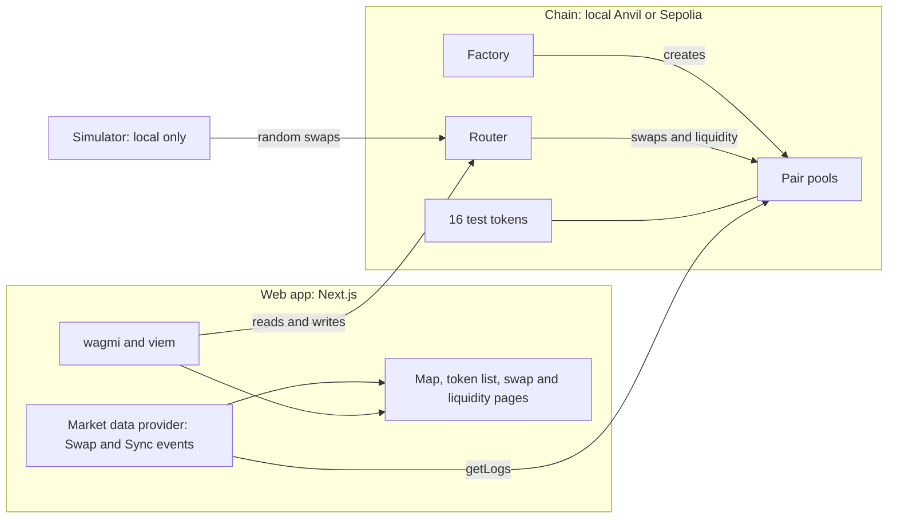

# Orrery

**Live Liquidity Network.** Orrery is an AMM (automated market maker) DEX: a decentralized exchange where users swap tokens directly against liquidity pools instead of an order book. Liquidity providers deposit token pairs into pools, and prices are set automatically by a formula based on the reserves in each pool. It runs on a local Anvil chain with a live visual dashboard, where tokens are drawn as planets in a network graph. Pools are the links between them, sized by TVL and colored by buy/sell pressure.

## What's inside

- **Contracts** (Solidity, Foundry): factory, router and pair contracts, plus 16 test tokens with mixed decimals (6, 8 and 18).
- **Web app** (Next.js, TypeScript): token network graph, ranked token panel (volume, 5m/1h/24h windows), pools, swap and liquidity pages, and a live trade feed.
- **Simulator**: a script that funds wallets and sends random small/medium/large swaps, so the dashboard has live activity.

## Prerequisites

- [Foundry](https://book.getfoundry.sh/) (`forge`, `anvil`, `cast`)
- Node.js and npm
- Git (Windows users: run everything inside WSL)

## Quick start

```bash
git clone --recurse-submodules https://github.com/rashi-365/Orrery.git
cd Orrery

cp .env.example .env
# edit .env: set DEPLOYER_PRIVATE_KEY to Anvil's account (0) key
# 0xac0974bec39a17e36ba4a6b4d238ff944bacb478cbed5efcae784d7bf4f2ff80
# (a public test key; never put a real key here)

(cd web && npm install)
(cd scripts && npm install)

bash scripts/up.sh --sim
```

Then open <http://localhost:3000>.

`up.sh` starts a fresh Anvil, deploys the contracts, builds the site (only if the source changed), starts it, and with `--sim` starts the trade simulator. Logs are in `/tmp/orrery`. Stop everything with:

```bash
bash scripts/down.sh
```

Leave out `--sim` to run without the simulator.

## Architecture



## Run on Sepolia

The same contracts are deployed on Sepolia (chain ID 11155111). To point the web app at them instead of the local chain:

```bash
cd web
echo "NEXT_PUBLIC_CHAIN_ID=11155111" > .env.local
npm install
npm run build
npm run start
```

Then open <http://localhost:3000>, switch your wallet to Sepolia and connect. You need a little Sepolia ETH for gas, and the Test tokens panel on the home page gives you tokens to swap with. The simulator only runs on the local chain, so on Sepolia the dashboard shows real activity only: the 25 pools start with liquidity but no trade history. To go back to local mode, delete `web/.env.local` and rebuild.

### Sepolia contracts

| Contract | Address |
| --- | --- |
| Factory | [0x680122821D16D9A3Cd87c04188fcbadF52b87f0a](https://sepolia.etherscan.io/address/0x680122821D16D9A3Cd87c04188fcbadF52b87f0a) |
| Router | [0xFcc0E3678c28F965D01A9C46e39767eb0F38c958](https://sepolia.etherscan.io/address/0xFcc0E3678c28F965D01A9C46e39767eb0F38c958) |

| Token | Name | Address |
| --- | --- | --- |
| LUNA | Luna | [0x3B1bf29EDc6ba9D5441569a2dB49719134D71662](https://sepolia.etherscan.io/address/0x3B1bf29EDc6ba9D5441569a2dB49719134D71662) |
| TERR | Terra | [0x24AC8851A62adA0Bc2c9Fb1c2825aa4d85dEcD36](https://sepolia.etherscan.io/address/0x24AC8851A62adA0Bc2c9Fb1c2825aa4d85dEcD36) |
| IO | Io | [0x2BA85E22bb4E01d2cC08773507382cdb9B661862](https://sepolia.etherscan.io/address/0x2BA85E22bb4E01d2cC08773507382cdb9B661862) |
| EURA | Europa | [0x51c208b3dF9f20198B8A1DCda97faD9712D078F5](https://sepolia.etherscan.io/address/0x51c208b3dF9f20198B8A1DCda97faD9712D078F5) |
| PHOB | Phobos | [0x846ec51cBeA0a4c66E503D2c72E9361B0e8A3445](https://sepolia.etherscan.io/address/0x846ec51cBeA0a4c66E503D2c72E9361B0e8A3445) |
| MERC | Mercury | [0x846894363d0EdFEc5B3a6B0326e7BB17a623A52b](https://sepolia.etherscan.io/address/0x846894363d0EdFEc5B3a6B0326e7BB17a623A52b) |
| VENU | Venus | [0xbdbf4435c969841212B1eF6c6089f21A7fFfEDc5](https://sepolia.etherscan.io/address/0xbdbf4435c969841212B1eF6c6089f21A7fFfEDc5) |
| MARS | Mars | [0x93972B2eafdE688c13b7E334222DCB10cbB756E1](https://sepolia.etherscan.io/address/0x93972B2eafdE688c13b7E334222DCB10cbB756E1) |
| CALL | Callisto | [0x5bA4171402E97bd0fd50e7cCBbCe76d88Dd5B50d](https://sepolia.etherscan.io/address/0x5bA4171402E97bd0fd50e7cCBbCe76d88Dd5B50d) |
| JOVE | Jupiter | [0x8931EB1cad13985abb966B262982d3Fc89B1540D](https://sepolia.etherscan.io/address/0x8931EB1cad13985abb966B262982d3Fc89B1540D) |
| SATU | Saturn | [0x3B13965302C6fd9A49c4193D8b8D59DBd0d6BEe3](https://sepolia.etherscan.io/address/0x3B13965302C6fd9A49c4193D8b8D59DBd0d6BEe3) |
| URAN | Uranus | [0x627811F26136a0DF058Dc322B880057129B6E414](https://sepolia.etherscan.io/address/0x627811F26136a0DF058Dc322B880057129B6E414) |
| NEPT | Neptune | [0x66fa1f8f5942BDF2d11Fb8eEF7b12dD5d768CC88](https://sepolia.etherscan.io/address/0x66fa1f8f5942BDF2d11Fb8eEF7b12dD5d768CC88) |
| GANY | Ganymede | [0x5A0D15E9Ab91fC145aEFcD616D88494aA95c67A2](https://sepolia.etherscan.io/address/0x5A0D15E9Ab91fC145aEFcD616D88494aA95c67A2) |
| TITA | Titan | [0x75411CcA0dAC779a01e8Cced4456CD8119Fa8Ffa](https://sepolia.etherscan.io/address/0x75411CcA0dAC779a01e8Cced4456CD8119Fa8Ffa) |
| TRIT | Triton | [0xc7e44FD9d45Af856D30245788e8b67F889e32BD5](https://sepolia.etherscan.io/address/0xc7e44FD9d45Af856D30245788e8b67F889e32BD5) |

## Using a wallet

1. Add a network in MetaMask: RPC `http://127.0.0.1:8545`, chain ID `31337`.
2. Import an Anvil test account if you need funded ETH.
3. After every restart the chain is fresh, so clear MetaMask's activity tab data (Settings, Advanced) to reset its nonces.

## Project layout

```
contracts/   Solidity contracts + Foundry deploy script
web/         Next.js frontend (config/deployments/31337.json holds local addresses)
scripts/     up.sh / down.sh and the trade simulator
```

## Troubleshooting

- `STOP: DEPLOYER_PRIVATE_KEY ... must be Anvil account (0)`: the key in `.env` is not Anvil's first account.
- `STOP: the deployed addresses differ from the committed ones`: the deployment didn't start from a clean chain. Run `bash scripts/down.sh` and try again.
- Dashboard shows `$0.00` everywhere: give the simulator a minute, or check `/tmp/orrery/simulator.log`.

## Security

For local development and demos only. See [SECURITY.md](SECURITY.md).
